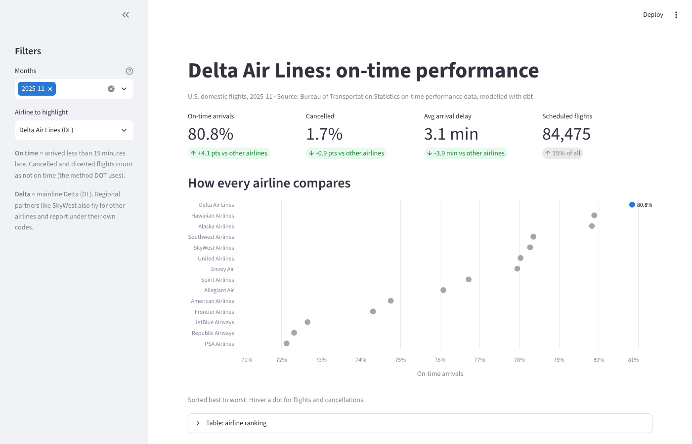
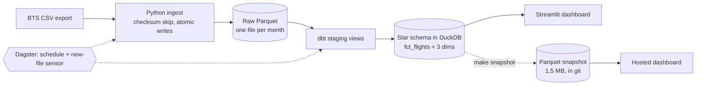

# Delta Flight Delay Pipeline

[](https://github.com/Stickyfingers22/delta-flight-pipeline/actions/workflows/ci.yml)

An end-to-end batch data pipeline on U.S. Bureau of Transportation Statistics (BTS) flight data. It covers ingestion to Parquet, a dbt star schema in DuckDB, Dagster orchestration, CI on every push, and a Streamlit dashboard comparing Delta's on-time performance with every other U.S. airline.

**[Live dashboard](https://delta-flight-pipeline.streamlit.app)** · [Build log](docs/build-log.md): every step, decision and interview question · [Data model](docs/data-model.md)

[](https://delta-flight-pipeline.streamlit.app)

## What the data says (November 2025, 570,550 flights)

- **Delta ranked #1 of 14 airlines on time:** 80.8% vs 76.7% for everyone else, with fewer cancellations (1.7% vs 2.6%).
- **Delta's delays start at Delta but spread less:**
  - More airline-caused delay minutes per 100 flights than other airlines (527 vs 429).
  - Far fewer delay minutes from late incoming aircraft (379 vs 594).
- **Hub advantage:** at Atlanta, Delta flights arrived on time 80% of the time vs 72% for other airlines flying from the same airport.
- **Nov 7–10:** on-time fell to 48% on Nov 9 and cancellations rose from 0.5% to 12.1%. This lines up with the FAA ordering flight cuts at major airports during the government shutdown.

"On time" uses the DOT method: arrived less than 15 minutes late, with cancelled and diverted flights counted as not on time. "Delta" means mainline Delta (DL); regional partners report under their own codes.

## Architecture



| Layer | Tool | Why this tool |
|---|---|---|
| Ingest | Python, pandas, Parquet | Columnar, compressed, readable by everything downstream |
| Warehouse | DuckDB | A full SQL warehouse in one file; no server to run |
| Model | dbt | Version-controlled SQL with tests and lineage built in |
| Orchestrate | Dagster | Treats tables as assets and reads the dbt project directly, so dbt tests show up as checks |
| Serve | Streamlit, Altair | A dashboard in Python, tested in CI along with the pipeline |
| CI | GitHub Actions, Docker | Lint and all tests on two Python versions, plus a clean Docker build, on every push |

## How it's tested

| Layer | Count | Examples |
|---|---|---|
| dbt unit tests | 3 | `"2400"` becomes midnight; cancelled beats diverted; multi-leg flights get different keys |
| dbt data tests | 39 | Unique keys, every flight joins to each dimension, delay flags match minutes, every day present |
| pytest | 53 | Ingestion and idempotency; an end-to-end run on a committed 442-row real sample; Dagster wiring; dashboard numbers recomputed independently with pandas; the hosted snapshot matches the warehouse |

The tests were tested: I broke the code on purpose six ways, and the right test failed each time. For example:
- Dropping a column from the flight key
- Forgetting the `"2400"` rule
- Changing the on-time definition

Details are in the [build log](docs/build-log.md).

## Design decisions worth asking about

- **Grain:** one row per flight leg. Date + airline + flight number repeats 95,715 times in a month, so the key includes the origin airport. ([data model](docs/data-model.md))
- **Idempotent ingestion:** files with an unchanged checksum are skipped. Each month is written to a temp file and swapped in, so a crash never leaves half a file.
- **Fail loudly:** staging uses `CAST`, not `TRY_CAST`, so a malformed value fails the build instead of becoming a silent NULL. A test proves it.
- **A known data gap, kept visible:** 11 Southwest flights, 93 to 820 minutes late, report zero for every delay cause. The test warns on them and fails only if the count grows.
- **Hosting without the warehouse:** the 75 MB warehouse stays out of git. `make snapshot` exports only the columns the dashboard reads (1.5 MB of Parquet), and a test checks that the snapshot gives the same numbers as the warehouse.

## Run it

```bash
make setup        # create .venv and install dependencies
make ingest-file FILE=data/landing/flight_delays_2025_11.csv   # load a BTS export
make build        # dbt: seeds, models and all tests, in dependency order
make dashboard    # http://localhost:8501
make dagster      # http://localhost:3000: asset graph, runs, schedule, sensor
make test         # all 53 tests (~30s); make test-fast skips the slow end-to-end ones
make lint         # ruff, same as CI
make snapshot     # refresh dashboard/snapshot/ for the hosted dashboard, then commit it
```

Get the data: export a month from [BTS On-Time Performance](https://www.transtats.bts.gov/DL_SelectFields.aspx?gnoyr_VQ=FGJ&QO_fu146_anzr=b0-gvzr) and save the CSV to `data/landing/`. Raw data isn't committed; one month is about 115 MB.

## Project layout

```
src/delta_pipeline/   ingest, profiling, Dagster definitions, dashboard metrics, snapshot export
dbt/                  seeds, staging and mart models, singular tests, macros
dashboard/            Streamlit app, its hosted requirements and the committed snapshot
tests/                pytest, plus the 442-row real-data sample
docs/                 build log, data model, images
.github/workflows/    CI
```

## Limitations and next steps

- **One month loaded.** The pipeline handles any number of months, but monthly Dagster partitions would make backfills cleaner.
- **No tail numbers.** The BTS export used here has no aircraft tail numbers, so delays can't be traced from one flight to the next aircraft rotation.
- **Next project:** a flight-delay prediction model trained on these marts.
