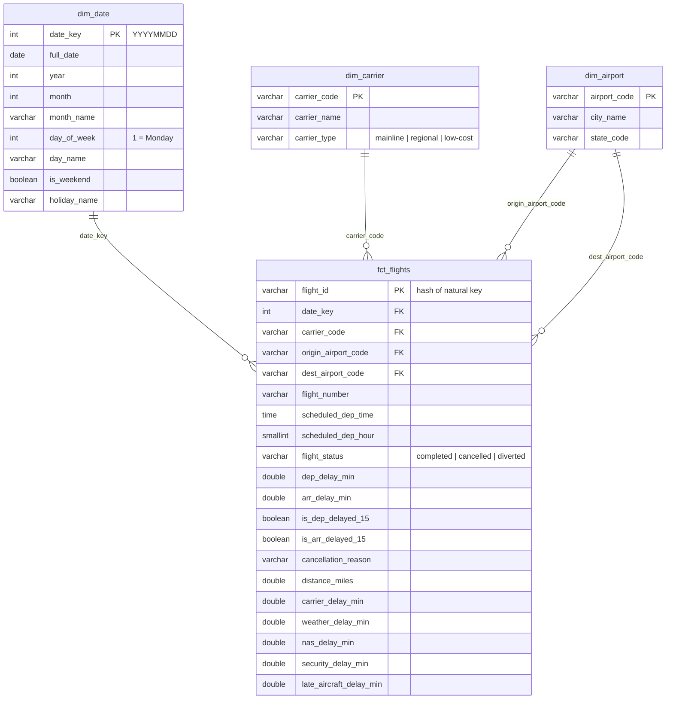

# Data Model

A star schema: one fact table of flights, surrounded by dimension tables that describe them. Every decision below is backed by a check in `src/delta_pipeline/profile.py` (run `make profile`). Numbers are from November 2025: 570,550 flights.

## The grain: one row per scheduled flight leg

The grain is the single most important decision: it says exactly what one row in the fact table means.

**One row = one scheduled flight leg**, whether it completed, was cancelled or was diverted.

| Candidate key | Duplicate rows | Verdict |
|---|---|---|
| date + carrier + flight number | 95,715 | Not unique: one flight number often flies several legs a day (ATL→JFK, then JFK→BOS) |
| date + carrier + flight number + **origin** | 0 | **Unique.** This is the natural key |

`flight_id` is a hash of those four columns. A single key column is easier to join on and to test than four.

Cancelled flights stay in the fact table. Dropping them would hide 14,195 of the worst outcomes for passengers, and cancellation rate is a core KPI.

## Fact table: `fct_flights`

| Column | Source | Rule |
|---|---|---|
| `flight_id` | hash of natural key | Unique, not null |
| `date_key` | `FlightDate` → `YYYYMMDD` integer | Joins to `dim_date` |
| `carrier_code` | `Reporting_Airline` | Joins to `dim_carrier` |
| `origin_airport_code`, `dest_airport_code` | `Origin`, `Dest` | Both join to `dim_airport` (a *role-playing* dimension: one table, two roles) |
| `scheduled_dep_time` | `CRSDepTime` `"HHMM"` → `TIME` | Local airport time; BTS gives no time zone |
| `scheduled_dep_hour` | from above | For "delays by hour of day" |
| `flight_status` | `Cancelled`, `Diverted` | `cancelled` if Cancelled = 1, `diverted` if Diverted = 1, else `completed` |
| `dep_delay_min`, `arr_delay_min` | `DepDelay`, `ArrDelay` | Negative = early. Keep extremes (max 2,726 min ≈ 45 h is real) |
| `is_dep_delayed_15`, `is_arr_delayed_15` | `DepDel15`, `ArrDel15` | The industry's on-time definition: 15+ minutes late |
| `cancellation_reason` | `CancellationCode` | A carrier · B weather · C national air system · D security |
| `distance_miles` | `Distance` | |
| `*_delay_min` (5 causes) | `CarrierDelay` … `LateAircraftDelay` | Only filled when the flight arrived 15+ min late |

**Null rules the data confirms (these become dbt tests in step 6):**

| Rule | Evidence |
|---|---|
| Cancelled flights never have an arrival delay | 0 of 14,195 |
| Diverted flights never have an arrival delay | 0 of 1,059 |
| Some cancelled flights *do* have a departure delay | 258 left the gate, then were cancelled. Not an error |
| Every flight arriving 15+ min late has cause minutes | 0 missing of 114,170 |
| Cause minutes add up to the arrival delay | All but 11 of 114,170. The 11 are Southwest flights 93–820 minutes late that reported 0 for every cause: a gap in the source, not rounding. The test warns on them and fails above 100 |

**Formats staging must handle:** times stored as `"HHMM"` text. Actual times use `"2400"` for midnight 335 times (43 departures, 292 arrivals), which must become `00:00`; scheduled times never do. No delay value failed to parse as a number.

## Dimensions

### `dim_date` — generated, not loaded
One row per calendar day, built with SQL rather than taken from flights, so days with no flights still exist. It includes `holiday_name` because holidays move demand: Thanksgiving (Nov 27, 2025) had 11,001 flights versus a median of about 19,900 per day.

### `dim_carrier` — reference file (dbt seed)
BTS gives only two-letter codes, so names come from a small CSV checked into the repo:

| Code | Name | Type |
|---|---|---|
| DL | Delta Air Lines | mainline |
| AA | American Airlines | mainline |
| UA | United Airlines | mainline |
| WN | Southwest Airlines | low-cost |
| AS | Alaska Airlines | mainline |
| HA | Hawaiian Airlines | mainline |
| B6 | JetBlue Airways | low-cost |
| F9 | Frontier Airlines | low-cost |
| NK | Spirit Airlines | low-cost |
| G4 | Allegiant Air | low-cost |
| OO | SkyWest Airlines | regional |
| YX | Republic Airways | regional |
| MQ | Envoy Air | regional |
| OH | PSA Airlines | regional |

**Caveat that matters for "Delta" analysis:** BTS reports the *operating* carrier. `DL` means flights flown by Delta itself. Delta Connection flights flown by regional partners (for example SkyWest) appear under the regional's code. This export has no marketing-carrier column, so "Delta" in this project means Delta mainline. The dashboard will say so.

### `dim_airport` — derived from the data
The union of every origin and destination: 340 airports. Destinations are included because an airport could appear only as a destination in a given month. Each code has exactly one city and state (0 conflicts), so a simple distinct is safe. If a city name ever changes, the newest value wins (*SCD Type 1*: overwrite, no history kept).

## Decisions and trade-offs

| Decision | Alternative | Why this one |
|---|---|---|
| Star schema | One wide flat table | Dimensions are reused (airport twice), changes happen in one place, and it's what BI tools and interviewers expect |
| Natural codes (`DL`, `ATL`) as dimension keys | Integer surrogate keys | IATA codes are stable, readable and already unique. Surrogates add a lookup with little benefit at this scale |
| Hashed `flight_id` for the fact | Composite 4-column key | One column is simpler to join, test and reference from the ML project |
| Keep cancelled and diverted flights | Completed flights only | Cancellation rate is a KPI; dropping them biases every average |
| No route dimension | `dim_route` | Origin + destination on the fact already define the route (5,741 pairs); distance lives on the flight |
| Local times, no time zone | Convert to UTC | BTS gives no time zone. Converting needs an airport→time zone lookup; worth adding only if we compare times across zones |

## Not in this export (possible extensions)
- `Tail_Number`: needed to follow one aircraft through its day and measure delay cascades.
- Marketing carrier: needed to include Delta Connection flights under Delta.
